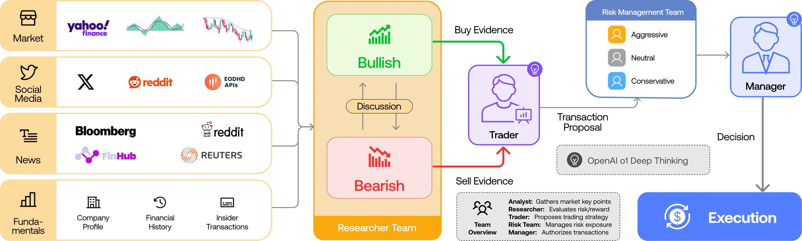
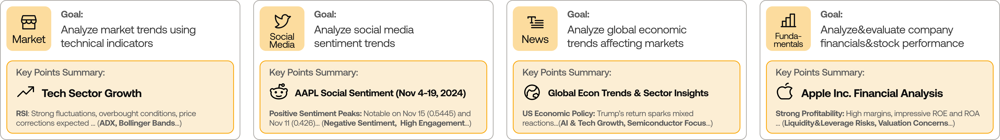

<p align="center">
  
</p>

<div align="center" style="line-height: 1;">
  <a href="https://arxiv.org/abs/2412.20138" target="_blank"></a>
  <a href="https://discord.com/invite/hk9PGKShPK" target="_blank"></a>
  <a href="./assets/wechat.png" target="_blank"></a>
  <a href="https://x.com/TauricResearch" target="_blank"></a>
  <a href="https://github.com/TauricResearch/TradingActions/actions" target="_blank"></a>
  <a href="https://pypi.org/project/tradingagents/" target="_blank"></a>
  <br>
  <a href="https://github.com/TauricResearch/" target="_blank"></a>
</div>

<div align="center">
  <a href="https://www.readme-i18n.com/TauricResearch/TradingAgents?lang=de">Deutsch</a> | 
  <a href="https://www.readme-i18n.com/TauricResearch/TradingAgents?lang=es">Español</a> | 
  <a href="https://www.readme-i18n.com/TauricResearch/TradingAgents?lang=fr">français</a> | 
  <a href="https://www.readme-i18n.com/TauricResearch/TradingAgents?lang=ja">日本語</a> | 
  <a href="https://www.readme-i18n.com/TauricResearch/TradingAgents?lang=ko">한국어</a> | 
  <a href="https://www.readme-i18n.com/TauricResearch/TradingAgents?lang=pt">Português</a> | 
  <a href="https://www.readme-i18n.com/TauricResearch/TradingAgents?lang=ru">Русский</a> | 
  <a href="https://www.readme-i18n.com/TauricResearch/TradingAgents?lang=zh">中文</a>
</div>

---

# TradingAgents: Multi-Agents LLM Financial Trading Framework 

> 🎉 **TradingAgents** is a production-ready, open-source multi-agent trading framework that mirrors the dynamics of real-world trading firms. Built with clean architecture principles, comprehensive type hints, and extensive documentation.

<div align="center">
<a href="https://www.star-history.com/#TauricResearch/TradingAgents&Date">
 <picture>
   <source media="(prefers-color-scheme: dark)" srcset="https://api.star-history.com/svg?repos=TauricResearch/TradingAgents&type=Date&theme=dark" />
   <source media="(prefers-color-scheme: light)" srcset="https://api.star-history.com/svg?repos=TauricResearch/TradingAgents&type=Date" />
   
 </picture>
</a>
</div>

<div align="center">

🚀 [Quick Start](#quick-start) | 📦 [Installation](#installation) | 🔧 [Configuration](#configuration) | 🧪 [Testing](#testing) | 📚 [Documentation](#documentation) | 🐳 [Docker](#docker-deployment) | 🤝 [Contributing](#contributing)

</div>

## Overview

TradingAgents is a multi-agent trading framework that deploys specialized LLM-powered agents—from fundamental analysts and sentiment experts to technical analysts, traders, and risk management teams—to collaboratively evaluate market conditions and inform trading decisions.

<p align="center">
  
</p>

> **⚠️ Disclaimer**: TradingAgents is designed for research and educational purposes. Trading performance may vary based on many factors. [It is not intended as financial, investment, or trading advice.](https://tauric.ai/disclaimer/)

### Key Features

- 🏗️ **Clean Architecture**: Separated concerns with proper abstraction layers
- 📝 **Type Safety**: Comprehensive type hints throughout the codebase
- 🐳 **Docker Support**: Production-ready containerization
- ✅ **CI/CD Pipeline**: Automated testing, linting, and deployment
- 📊 **Multi-Agent System**: Specialized agents for different trading aspects
- 🔧 **Configurable**: Flexible configuration system with environment variables
- 🧪 **Well-Tested**: Comprehensive test suite with high coverage

## Quick Start

### Installation

```bash
# Clone the repository
git clone https://github.com/TauricResearch/TradingAgents.git
cd TradingAgents

# Create a virtual environment
python -m venv venv
source venv/bin/activate  # On Windows: venv\Scripts\activate

# Install dependencies
pip install -r requirements.txt

# Or install as a package
pip install -e .
```

### Configuration

Create a `.env` file from the example:

```bash
cp .env.example .env
```

Edit `.env` and add your API keys:

```bash
# Required
OPENAI_API_KEY=your_openai_api_key_here
FINNHUB_API_KEY=your_finnhub_api_key_here

# Optional
ANTHROPIC_API_KEY=your_anthropic_api_key_here
GOOGLE_API_KEY=your_google_api_key_here
```

### Basic Usage

```python
from tradingagents import TradingAgentsGraph, DEFAULT_CONFIG

# Initialize with default configuration
ta = TradingAgentsGraph(debug=True, config=DEFAULT_CONFIG.copy())

# Run analysis
state, decision = ta.propagate("NVDA", "2024-05-10")
print(decision)
```

### CLI Usage

```bash
# Run the interactive CLI
python -m cli.main analyze

# Or use the installed command
tradingagents analyze
```

## Architecture

The framework decomposes complex trading tasks into specialized roles:

### Analyst Team
- **Fundamentals Analyst**: Evaluates company financials and performance metrics
- **Sentiment Analyst**: Analyzes social media and public sentiment
- **News Analyst**: Monitors global news and macroeconomic indicators
- **Technical Analyst**: Uses technical indicators (MACD, RSI) for pattern detection

### Researcher Team
- **Bull/Bear Researchers**: Debate investment opportunities from both perspectives

### Risk Management
- **Risk Analysts**: Evaluate portfolio risk and adjust trading strategies
- **Portfolio Manager**: Approves/rejects transaction proposals

<p align="center">
  
</p>

## Docker Deployment

### Quick Start with Docker

```bash
# Build the Docker image
docker build -t tradingagents .

# Run with environment variables
docker run -it --rm \
  -e OPENAI_API_KEY=$OPENAI_API_KEY \
  -e FINNHUB_API_KEY=$FINNHUB_API_KEY \
  tradingagents
```

### Docker Compose

```bash
# Start all services
docker-compose up -d

# View logs
docker-compose logs -f tradingagents

# Stop services
docker-compose down
```

## Development

### Setup Development Environment

```bash
# Install development dependencies
pip install -r requirements-dev.txt

# Install pre-commit hooks
pre-commit install

# Run validation
make validate
```

### Testing

```bash
# Run all tests
make test

# Run with coverage
make test-cov

# Run specific test types
make test-unit        # Unit tests only
make test-integration # Integration tests only
```

### Code Quality

```bash
# Format code
make format

# Run linters
make lint

# Run type checker
mypy tradingagents cli
```

## Configuration

### Environment Variables

| Variable | Description | Default |
|----------|-------------|---------|
| `OPENAI_API_KEY` | OpenAI API key | Required |
| `FINNHUB_API_KEY` | FinnHub API key | Required |
| `TRADINGAGENTS_LLM_PROVIDER` | LLM provider (openai/anthropic/google) | openrouter |
| `TRADINGAGENTS_DEEP_THINK_LLM` | Model for deep analysis | anthropic/claude-3.5-sonnet |
| `TRADINGAGENTS_QUICK_THINK_LLM` | Model for quick tasks | anthropic/claude-3.5-haiku |
| `TRADINGAGENTS_MAX_DEBATE_ROUNDS` | Maximum debate rounds | 1 |
| `TRADINGAGENTS_ONLINE_TOOLS` | Use online data sources | true |
| `TRADINGAGENTS_LOG_LEVEL` | Logging level | INFO |

### Custom Configuration

```python
from tradingagents import TradingAgentsGraph, create_config

# Create custom configuration
config = create_config(
    llm_provider="openai",
    deep_think_llm="gpt-4",
    quick_think_llm="gpt-4o-mini",
    max_debate_rounds=2,
    online_tools=True
)

# Validate configuration
from tradingagents.default_config import validate_config
errors = validate_config(config)
if errors:
    print(f"Configuration errors: {errors}")

# Use custom config
ta = TradingAgentsGraph(config=config)
```

## GitHub Codespaces

[](https://codespaces.new/TauricResearch/TradingAgents)

1. Click the button above to launch a Codespace
2. Wait for setup (~3-5 minutes)
3. Set your API keys in the terminal
4. Run validation: `python validate_setup.py`

## Documentation

- [API Documentation](https://github.com/TauricResearch/TradingAgents/wiki)
- [Configuration Guide](docs/configuration.md)
- [Deployment Guide](docs/deployment.md)
- [Contributing Guide](CONTRIBUTING.md)

## Project Structure

```
TradingAgents/
├── tradingagents/          # Main package
│   ├── agents/            # Trading agents
│   │   ├── analysts/      # Market, sentiment, news, fundamentals
│   │   ├── researchers/   # Bull/bear researchers
│   │   ├── risk_mgmt/     # Risk management agents
│   │   └── utils/         # Agent utilities
│   ├── dataflows/         # Data ingestion
│   ├── graph/             # LangGraph workflows
│   └── exceptions.py      # Custom exceptions
├── cli/                   # Command-line interface
├── tests/                 # Test suite
│   ├── unit/             # Unit tests
│   ├── integration/      # Integration tests
│   └── e2e/              # End-to-end tests
├── .github/workflows/     # CI/CD pipelines
├── Dockerfile            # Container definition
├── docker-compose.yml    # Orchestration
├── pyproject.toml        # Project metadata
└── requirements.txt      # Dependencies
```

## CI/CD Pipeline

The project includes GitHub Actions workflows for:

- **Lint & Format**: Black, isort, flake8, mypy
- **Testing**: pytest with coverage reporting
- **Security**: Bandit security scanning
- **Build**: Package building and validation
- **Docker**: Container image building
- **Release**: Automated PyPI publishing

## Contributing

We welcome contributions! Please see [CONTRIBUTING.md](CONTRIBUTING.md) for guidelines.

### Development Workflow

1. Fork the repository
2. Create a feature branch: `git checkout -b feature/my-feature`
3. Make your changes with tests
4. Run the test suite: `make test`
5. Commit with clear messages
6. Push and create a Pull Request

## Troubleshooting

### Common Issues

**API Rate Limits**
```python
# Add delays between requests or use caching
config["online_tools"] = False  # Use cached data
```

**Memory Issues**
```python
# Reduce debate rounds
config["max_debate_rounds"] = 1
```

**Import Errors**
```bash
# Ensure package is installed
pip install -e .
```

## Citation

If you use TradingAgents in your research, please cite:

```bibtex
@misc{xiao2025tradingagentsmultiagentsllmfinancial,
      title={TradingAgents: Multi-Agents LLM Financial Trading Framework}, 
      author={Yijia Xiao and Edward Sun and Di Luo and Wei Wang},
      year={2025},
      eprint={2412.20138},
      archivePrefix={arXiv},
      primaryClass={q-fin.TR},
      url={https://arxiv.org/abs/2412.20138}, 
}
```

## License

This project is licensed under the Apache License 2.0 - see the [LICENSE](LICENSE) file for details.

## Acknowledgments

- Built with [LangGraph](https://github.com/langchain-ai/langgraph)
- Inspired by real-world trading firm workflows
- Thanks to all contributors and the open-source community

## Support

- 📧 Email: yijia.xiao@cs.ucla.edu
- 💬 Discord: [Join our community](https://discord.com/invite/hk9PGKShPK)
- 🐦 Twitter: [@TauricResearch](https://x.com/TauricResearch)

---

<div align="center">
  <sub>Built with ❤️ by the TradingAgents Team at Tauric Research</sub>
</div>
